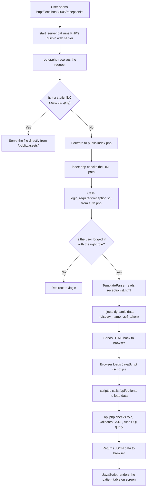
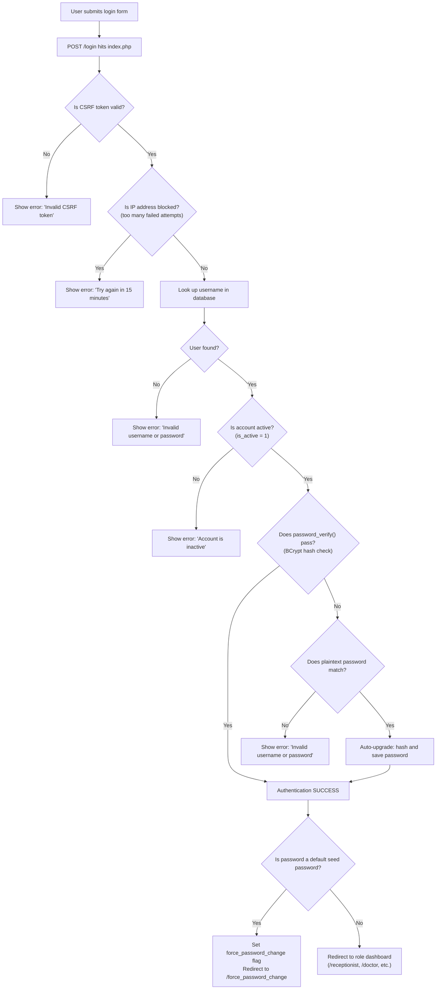

# Hospital Portal — Beginner-Friendly Developer Handover

> **Audience**: Junior Developer · Vibe Coder · Freelancer · Anyone seeing this project for the first time.
>
> If you can read basic PHP and HTML, you can understand this system. Every technical term is explained in plain English the first time it is used.

---

## Table of Contents

1. [What This Project Is](#1-what-this-project-is)
2. [Folder Structure — What Lives Where](#2-folder-structure--what-lives-where)
3. [How the System Works (Architecture)](#3-how-the-system-works-architecture)
4. [The Database — Where All Data Is Stored](#4-the-database--where-all-data-is-stored)
5. [User Accounts and Roles](#5-user-accounts-and-roles)
6. [Login and Authentication — How Users Get In](#6-login-and-authentication--how-users-get-in)
7. [Security Features](#7-security-features)
8. [Templates — The HTML Pages Users See](#8-templates--the-html-pages-users-see)
9. [The API — How the Frontend Talks to the Backend](#9-the-api--how-the-frontend-talks-to-the-backend)
10. [PDF Generation](#10-pdf-generation)
11. [How to Start the Application Locally](#11-how-to-start-the-application-locally)
12. [Backup and Recovery](#12-backup-and-recovery)
13. [What Changed Over Time (Changelog)](#13-what-changed-over-time-changelog)
14. [Common Problems and Troubleshooting](#14-common-problems-and-troubleshooting)
15. [Rules for Safely Modifying the Code](#15-rules-for-safely-modifying-the-code)
16. [Glossary of Terms](#16-glossary-of-terms)

---

# 1. What This Project Is

This is a **hospital management portal** built for **Crescent Clinic and Scans**, a real medical clinic. It runs on a single Windows computer inside the clinic and is accessed through a web browser (like Chrome).

### What the clinic uses it for

| Task | Who Does It |
|------|-------------|
| Register new patients, assign tokens, and record vitals (blood pressure, temperature, etc.) | **Receptionist** |
| View patient queue, write diagnoses, prescribe medicines, order injections/scans | **Doctor** |
| Dispense medicines, manage pharmacy stock, handle direct sales, process billing | **Pharmacist** |
| Manage users, view reports, control staff, manage supplier invoices, oversee every module | **Management (Admin)** |
| Display the patient waiting list on a TV in the waiting hall | **Monitor (TV Display)** |

### What each user can do

- **Receptionist**: Registers patients, enters vitals, looks up patient history, generates tokens.
- **Doctor** (there are two — a male and a female doctor): Views their own patient queue, writes prescriptions, uploads diagnosis photos.
- **Pharmacist**: Receives prescriptions, dispenses medicines, manages stock/inventory, handles direct over-the-counter sales, generates PDF bills.
- **Management**: Has access to *everything*. Can also manage user accounts, view financial reports, manage supplier invoices (agency module), and control staff records.
- **Monitor**: A view-only screen that displays the current waiting queue on a TV in the clinic's waiting hall.

---

# 2. Folder Structure — What Lives Where

Here is the project's folder layout, with a plain-English explanation for every folder and important file:

```
hospital_portal for last update 18-6-2026/
│
├── .env                          ← Settings file (database path, environment mode)
├── .env.example                  ← Example settings for new setups
├── .htaccess                     ← Apache web server rules (not used with PHP dev server)
├── router.php                    ← Entry point when running with PHP's built-in server
├── start_server.bat              ← Double-click this file to start the application
│
├── app/                          ← Application logic (the "brain")
│   ├── controllers/              ← (Empty) Placeholder for future controller classes
│   ├── helpers/                  ← Reusable helper functions
│   │   ├── db.php                ← Database connection + table creation + seed data
│   │   ├── db_helper.php         ← (Minimal utility)
│   │   ├── template_parser.php   ← Reads HTML files and fills in dynamic data
│   │   ├── audit_logger.php      ← Writes security/action logs to a file
│   │   └── pdf_gen.php           ← Generates PDF prescription/bill documents
│   ├── middleware/                ← Code that runs before every request
│   │   └── auth.php              ← Session handling, login checks, CSRF, brute-force block
│   ├── models/                   ← (Empty) Placeholder for future model classes
│   ├── services/                 ← Third-party libraries
│   │   └── fpdf_lib/             ← FPDF library — creates PDF files (no composer needed)
│   └── storage/                  ← (Alternate storage reference)
│
├── config/                       ← Configuration files
│   ├── app.php                   ← Defines folder paths (APP_ROOT, TEMPLATES_PATH, etc.)
│   └── database.php              ← Reads .env file and sets DB_PATH constant
│
├── database/                     ← Everything related to the database
│   ├── sqlite/
│   │   └── hospital_portal.db    ← ★ THE ACTUAL DATABASE FILE ★ (SQLite)
│   ├── schema/
│   │   └── schema.sql            ← Reference SQL — shows the original table definitions
│   └── migrations/               ← One-off scripts that added columns/tables over time
│
├── public/                       ← The web-facing root
│   ├── index.php                 ← ★ THE MAIN ROUTER ★ — all page URLs are handled here
│   ├── api/
│   │   ├── api.php               ← ★ ALL API ENDPOINTS ★ — the largest file (~3800 lines)
│   │   └── reports_api.php       ← Report-specific API endpoints
│   └── assets/
│       ├── css/
│       │   └── style.css         ← All visual styling (one big CSS file)
│       ├── js/
│       │   ├── script.js         ← Main JavaScript for all dashboards
│       │   ├── script_final.js   ← A frozen backup copy of script.js
│       │   ├── agency.js         ← JavaScript for the agency/supplier module
│       │   ├── agency_final.js   ← Frozen backup of agency.js
│       │   └── reports.js        ← JavaScript for the reports module
│       └── images/               ← Static images (logos, icons)
│
├── templates/                    ← HTML pages served to users
│   ├── login.html                ← Login screen
│   ├── force_password_change.html← Forced password reset page
│   ├── receptionist.html         ← Receptionist dashboard
│   ├── doctor.html               ← Doctor dashboard
│   ├── pharmacy.html             ← Pharmacy/billing dashboard
│   ├── management.html           ← Management admin dashboard (very large: 313 KB)
│   ├── monitor.html              ← TV waiting-hall display
│   └── portfolio.html            ← Public clinic info page
│
├── uploads/                      ← User-uploaded files (diagnosis photos, etc.)
├── storage/                      ← Application storage
│   ├── logs/                     ← audit.log lives here (security events)
│   ├── output/                   ← Generated output files
│   ├── reports/                  ← Generated reports
│   └── temp/                     ← Temporary files
│
├── scripts/                      ← Utility scripts
│   ├── backup.ps1                ← Automated database backup (PowerShell)
│   ├── setup_php.ps1             ← PHP environment setup helper
│   ├── debug/                    ← Debugging utilities
│   ├── fixes/                    ← One-off fix scripts
│   ├── maintenance/              ← Maintenance utilities
│   └── migration/                ← Data migration scripts
│
├── backup/                       ← Database backups live here
│   ├── backup_and_recovery.md    ← Step-by-step restore instructions
│   └── *.db                      ← Timestamped database backup files
│
├── backup_original/              ← Original untouched project backup
├── backup_phase1/                ← Backup after first round of changes
├── backup_phase2/                ← Backup after second round of changes
│
├── php/                          ← ★ BUNDLED PHP RUNTIME ★ (PHP 8.x)
│   ├── php.exe                   ← The PHP interpreter itself
│   ├── php.ini                   ← PHP configuration
│   └── (many .dll files)         ← PHP extensions (SQLite, OpenSSL, etc.)
│
└── tests/                        ← Test scripts (if any)
```

> [!IMPORTANT]
> The PHP runtime is **bundled inside the project** in the `php/` folder. You do NOT need to install PHP separately on the computer. The `start_server.bat` file uses this bundled PHP.

---

# 3. How the System Works (Architecture)

### What is "architecture"?

Architecture = how the different parts of the system are connected and how a user's request travels through the code.

### The Request Journey (step by step)

Here is what happens when someone opens `http://localhost:8005/receptionist` in their browser:



### The three layers

| Layer | What it does | Where in the code |
|-------|-------------|-------------------|
| **Frontend** (what the user sees) | HTML pages, CSS styling, JavaScript interactions | `templates/*.html`, `public/assets/css/style.css`, `public/assets/js/script.js` |
| **Backend** (the server logic) | Handles page requests, checks permissions, processes API calls | `public/index.php`, `public/api/api.php`, `app/middleware/auth.php` |
| **Database** (where data is stored) | Stores patients, prescriptions, inventory, users, billing | `database/sqlite/hospital_portal.db` |

### What is a "template parser"?

The templates (HTML files) contain placeholders like `{{ display_name }}` and `{{ csrf_token }}`. The `TemplateParser` class reads the HTML file, finds these placeholders, and replaces them with real values before sending the page to the browser.

**Where**: [template_parser.php](file:///c:/Users/Srimathi/Downloads/hospital_portal/hospital_portal%20for%20last%20update%2018-6-2026/app/helpers/template_parser.php)

**Supported syntax**:
- `{{ variable }}` — Replaced with an HTML-escaped value (safe against injection attacks)
- `{{{ variable }}}` — Replaced with raw HTML (no escaping — used when you need to insert HTML like doctor cards)
- `{{ url_for('static', filename='path') }}` — Converted to `/static/path` (compatible with the original Python version)
- ` ... ` — Conditionally shows content only if the variable exists and is truthy

---

# 4. The Database — Where All Data Is Stored

### What is SQLite?

SQLite is a database that stores everything in a **single file** — no separate database server needed. The file is:

```
database/sqlite/hospital_portal.db
```

This one file contains all tables, all patients, all prescriptions, all inventory — everything.

### Main Tables

| Table | What it stores | Key columns |
|-------|---------------|-------------|
| `users` | User accounts (doctors, receptionist, pharmacist, etc.) | `id`, `username`, `password`, `role`, `display_name`, `is_active` |
| `patients` | Patient registrations with vitals | `id`, `name`, `phone`, `doctor_id`, `token`, `status`, `bp`, `temp`, `weight` |
| `prescriptions` | Doctor prescriptions + billing | `id`, `patient_id`, `doctor_id`, `diagnosis`, `medicines` (JSON), `total_amount`, `paid_amount`, `balance_amount` |
| `inventory` | Pharmacy stock (medicine batches) | `id`, `name`, `batch_number`, `stock`, `selling_price`, `expiry_date` |
| `direct_sales` | Over-the-counter pharmacy sales (no doctor visit) | `id`, `customer_name`, `medicines`, `total_amount` |
| `staff_records` | Clinic staff information | `id`, `name`, `role`, `salary`, `status` |
| `staff_payments` | Staff salary/advance payments | `id`, `staff_id`, `payment_type`, `amount` |
| `login_attempts` | Brute-force protection tracking | `ip_address`, `attempts`, `last_attempt` |
| `agency_suppliers` | Medicine supplier/vendor records | `id`, `name`, `company_name`, `phone` |
| `agency_items` | Supplier-side inventory | `id`, `item_name`, `batch_number`, `stock` |
| `agency_purchases` | Purchase orders from suppliers | `id`, `supplier_id`, `invoice_number`, `grand_total` |
| `agency_purchase_items` | Individual items in a purchase order | `id`, `purchase_id`, `item_id`, `quantity` |
| `medicine_returns` | Medicine return records | `id`, `medicine_name`, `returned_qty`, `reason` |

### How tables are created

Tables are **NOT** created by running a SQL file manually. Instead, the function `init_db()` in [db.php](file:///c:/Users/Srimathi/Downloads/hospital_portal/hospital_portal%20for%20last%20update%2018-6-2026/app/helpers/db.php) runs automatically every time the application starts. It uses `CREATE TABLE IF NOT EXISTS` so tables are only created the first time.

### What are "migrations"?

Over time, new features needed new columns or tables. Rather than deleting and recreating the database (which would lose all patient data), "migration" code was added to `init_db()` and to scripts in `database/migrations/`. These scripts check if a column exists and add it only if it's missing:

```php
// Example: Adding a new column safely
$stmt = $conn->query("PRAGMA table_info(users)");
$cols = $stmt->fetchAll(PDO::FETCH_COLUMN, 1);
if (!in_array('is_active', $cols)) {
    $conn->exec("ALTER TABLE users ADD COLUMN is_active INTEGER DEFAULT 1");
}
```

**Why this matters**: The system is "self-healing" — if you copy the database from an older version, the app will automatically add any missing columns when it starts.

### How the database connects

1. [.env](file:///c:/Users/Srimathi/Downloads/hospital_portal/hospital_portal%20for%20last%20update%2018-6-2026/.env) contains `DB_DATABASE=database/sqlite/hospital_portal.db`
2. [config/database.php](file:///c:/Users/Srimathi/Downloads/hospital_portal/hospital_portal%20for%20last%20update%2018-6-2026/config/database.php) reads `.env` and sets `DB_PATH`
3. [app/helpers/db.php](file:///c:/Users/Srimathi/Downloads/hospital_portal/hospital_portal%20for%20last%20update%2018-6-2026/app/helpers/db.php) defines `get_db()` which creates a PDO connection to `DB_PATH`

---

# 5. User Accounts and Roles

### Default Seed Accounts

When the database is brand new (empty), the system creates these accounts automatically:

| Username | Original Default Password | Role | Display Name |
|----------|--------------------------|------|--------------|
| `receptionist` | `reception123` | receptionist | Receptionist |
| `dr.rasith` | `doctor123` | doctor (Gent) | Dr. Mohamed Rasith Sir |
| `dr.basheera` | `doctor123` | doctor (Lady) | Dr. Jannathul Basheera Mam |
| `pharmacist` | `pharma123` | pharmacist | Pharmacist |
| `management` | `admin123` | management | Management Admin |
| `monitor` | `monitor123` | monitor | TV Monitor |

> [!WARNING]
> These default passwords **no longer work** for direct login. The system forces every user to change their password the first time they log in with a default password. After that, only the new password works.

### Where seed accounts are created

Look at [db.php](file:///c:/Users/Srimathi/Downloads/hospital_portal/hospital_portal%20for%20last%20update%2018-6-2026/app/helpers/db.php) lines 241–256. The seed runs only when `SELECT COUNT(*) FROM users` returns 0.

### Role-Based Access Control (RBAC)

**What is RBAC?** It means different users can access different parts of the system based on their "role" (like receptionist, doctor, etc.).

**How it works**:
- When a user logs in, their role is saved in the `$_SESSION['role']` variable.
- Every page route calls `login_required('role_name')` which checks if the session role matches.
- Every API endpoint is mapped to a list of allowed roles in [api.php](file:///c:/Users/Srimathi/Downloads/hospital_portal/hospital_portal%20for%20last%20update%2018-6-2026/public/api/api.php) (around lines 332–386).
- The `management` role has global access — it can reach every page and every API endpoint.

---

# 6. Login and Authentication — How Users Get In

### What is "Authentication"?

Authentication = verifying that someone is who they say they are (checking username + password).

### The Login Flow (step by step)

Here's exactly what happens when someone types their username and password and clicks "Login":



### What is "password_verify"?

Passwords are stored as **BCrypt hashes** — scrambled versions that can't be unscrambled. `password_verify('user_input', 'stored_hash')` checks if the user's input matches the stored hash without revealing the actual password.

### What is the plaintext migration?

Originally, passwords were stored as plain text (e.g., `reception123` saved exactly as `reception123`). This was a security risk. Now, when someone logs in with a plaintext password:
1. It gets verified by exact string comparison
2. The password is immediately hashed with `password_hash()` and saved back to the database
3. Next time, `password_verify()` is used instead

**Where**: [index.php](file:///c:/Users/Srimathi/Downloads/hospital_portal/hospital_portal%20for%20last%20update%2018-6-2026/public/index.php) lines 72–79

### What is "forced password change"?

If a user logs in using any of the original default passwords (`reception123`, `doctor123`, etc.), the system:
1. Sets `$_SESSION['force_password_change'] = true`
2. Redirects them to `/force_password_change`
3. Blocks access to ALL pages and APIs until they set a new password (minimum 8 characters, cannot be a default password)

**Where**: [index.php](file:///c:/Users/Srimathi/Downloads/hospital_portal/hospital_portal%20for%20last%20update%2018-6-2026/public/index.php) lines 240–314 and [force_password_change.html](file:///c:/Users/Srimathi/Downloads/hospital_portal/hospital_portal%20for%20last%20update%2018-6-2026/templates/force_password_change.html)

---

# 7. Security Features

### 7.1 CSRF Protection

**What is CSRF?** Cross-Site Request Forgery — an attack where a malicious website tricks your browser into performing actions on a site where you're logged in (like changing data without your knowledge).

**How it's prevented here**:
1. When a user visits any page, a random token (a long random string) is generated and stored in their session.
2. This token is embedded in every HTML page in two ways:
   - As a hidden input field in forms: `<input type="hidden" name="csrf_token" value="...">`
   - As a meta tag: `<meta name="csrf-token" content="...">`
3. When the form is submitted or an API call is made, the token is sent along.
4. The server checks that the token matches what's in the session. If not, the request is rejected.

**Where**:
- Token generation: [auth.php](file:///c:/Users/Srimathi/Downloads/hospital_portal/hospital_portal%20for%20last%20update%2018-6-2026/app/middleware/auth.php) lines 21–53
- Auto-injection into templates: [template_parser.php](file:///c:/Users/Srimathi/Downloads/hospital_portal/hospital_portal%20for%20last%20update%2018-6-2026/app/helpers/template_parser.php) lines 13–15
- JavaScript auto-attachment to API calls: `window.api` wrapper in [script.js](file:///c:/Users/Srimathi/Downloads/hospital_portal/hospital_portal%20for%20last%20update%2018-6-2026/public/assets/js/script.js)

### 7.2 Brute-Force Protection

**What is brute-force?** An attacker tries many username/password combinations rapidly to guess the correct one.

**How it's prevented**:
- A `login_attempts` table tracks how many times each IP address has failed to log in.
- After **5 failed attempts**, the IP is blocked for **15 minutes**.
- On a successful login, the counter resets to zero.

**Where**: [auth.php](file:///c:/Users/Srimathi/Downloads/hospital_portal/hospital_portal%20for%20last%20update%2018-6-2026/app/middleware/auth.php) lines 82–112

### 7.3 Session Security

- **`HttpOnly` cookies**: Session cookies can't be read by JavaScript (prevents XSS theft)
- **`SameSite=Lax`**: Cookies aren't sent on cross-site requests (prevents CSRF)
- **Session regeneration**: After login, `session_regenerate_id(true)` is called to prevent session fixation attacks
- **24-hour expiry**: Sessions last 24 hours maximum

**Where**: [auth.php](file:///c:/Users/Srimathi/Downloads/hospital_portal/hospital_portal%20for%20last%20update%2018-6-2026/app/middleware/auth.php) lines 6–18

### 7.4 Audit Logging

Every important action is logged to a file at `app/storage/logs/audit.log` (or `storage/logs/audit.log`). Each log entry is a JSON object containing:

```json
{
  "timestamp": "2026-06-22T18:30:15+05:30",
  "user": "receptionist",
  "ip": "127.0.0.1",
  "action": "LOGIN",
  "details": "User successfully logged in: receptionist"
}
```

**Tracked events include**: `LOGIN`, `LOGOUT`, `LOGIN_FAILED`, `ACCOUNT_LOCKOUT`, `PASSWORD_UPGRADE`, `PASSWORD_CHANGED`, `PATIENT_UPDATED`, `PATIENT_DELETED`, `BILL_UPDATED`

**Where**: [audit_logger.php](file:///c:/Users/Srimathi/Downloads/hospital_portal/hospital_portal%20for%20last%20update%2018-6-2026/app/helpers/audit_logger.php)

---

# 8. Templates — The HTML Pages Users See

Each role has its own HTML file in the `templates/` folder:

| File | URL Path | Who Sees It | Size |
|------|----------|-------------|------|
| [login.html](file:///c:/Users/Srimathi/Downloads/hospital_portal/hospital_portal%20for%20last%20update%2018-6-2026/templates/login.html) | `/login` | Everyone (before login) | 3 KB |
| [force_password_change.html](file:///c:/Users/Srimathi/Downloads/hospital_portal/hospital_portal%20for%20last%20update%2018-6-2026/templates/force_password_change.html) | `/force_password_change` | Users with default passwords | 3 KB |
| [receptionist.html](file:///c:/Users/Srimathi/Downloads/hospital_portal/hospital_portal%20for%20last%20update%2018-6-2026/templates/receptionist.html) | `/receptionist` | Receptionist | 13 KB |
| [doctor.html](file:///c:/Users/Srimathi/Downloads/hospital_portal/hospital_portal%20for%20last%20update%2018-6-2026/templates/doctor.html) | `/doctor` | Doctor | 13 KB |
| [pharmacy.html](file:///c:/Users/Srimathi/Downloads/hospital_portal/hospital_portal%20for%20last%20update%2018-6-2026/templates/pharmacy.html) | `/pharmacy` | Pharmacist | 39 KB |
| [management.html](file:///c:/Users/Srimathi/Downloads/hospital_portal/hospital_portal%20for%20last%20update%2018-6-2026/templates/management.html) | `/management` | Management (Admin) | **313 KB** |
| [monitor.html](file:///c:/Users/Srimathi/Downloads/hospital_portal/hospital_portal%20for%20last%20update%2018-6-2026/templates/monitor.html) | `/monitor` | TV display | 17 KB |
| [portfolio.html](file:///c:/Users/Srimathi/Downloads/hospital_portal/hospital_portal%20for%20last%20update%2018-6-2026/templates/portfolio.html) | `/portfolio` | Public (no login) | 14 KB |

> [!NOTE]
> `management.html` is **very large** (313 KB) because it contains the entire admin dashboard — user management, staff records, supplier invoices, reports, analytics, and more — all in a single file using tab-based navigation.

### How templates connect to JavaScript

Each dashboard HTML file loads JavaScript from `public/assets/js/script.js`. The JavaScript uses the `window.api` helper to make API calls (e.g., fetch patients, submit prescriptions). The CSRF token is automatically attached to all API calls.

---

# 9. The API — How the Frontend Talks to the Backend

### What is an API?

An API (Application Programming Interface) is a way for the JavaScript in the browser to send/receive data to/from the server WITHOUT reloading the entire page. When you click "Save Patient" on the receptionist screen, JavaScript sends a request to `/api/register_patient`, and the server processes it and returns a response.

### Where APIs are defined

All API endpoints are in [api.php](file:///c:/Users/Srimathi/Downloads/hospital_portal/hospital_portal%20for%20last%20update%2018-6-2026/public/api/api.php) (3816 lines). Report APIs are in [reports_api.php](file:///c:/Users/Srimathi/Downloads/hospital_portal/hospital_portal%20for%20last%20update%2018-6-2026/public/api/reports_api.php).

### Key API Endpoints

| Endpoint | Method | What it does | Who can use it |
|----------|--------|-------------|----------------|
| `/api/doctors` | GET | List all active doctors | Receptionist, Doctor, Pharmacist, Management |
| `/api/register_patient` | POST | Register a new patient | Receptionist, Management |
| `/api/patients` | GET | List today's patients | Receptionist, Doctor, Pharmacist, Monitor, Management |
| `/api/patients/all` | GET | List ALL patients (historical) | Receptionist, Doctor, Pharmacist, Management |
| `/api/patients/lookup_by_phone` | GET | Search patients by phone number | Receptionist, Doctor, Pharmacist, Management |
| `/api/patient/{id}` | GET | Get specific patient details | Doctor, Pharmacist, Management |
| `/api/patient_history/{phone}` | GET | Get a patient's full visit history | Receptionist, Doctor, Pharmacist, Management |
| `/api/prescribe` | POST | Submit a prescription | Doctor, Management |
| `/api/add_medicines` | POST | Dispense medicines from pharmacy | Pharmacist, Management |
| `/api/direct_pharmacy` | POST | Create a direct sale (no doctor visit) | Pharmacist, Management |
| `/api/inventory/*` | Various | Manage pharmacy stock | Pharmacist, Management |
| `/api/generate_pdf/{id}` | GET | Generate prescription PDF | Pharmacist, Receptionist, Doctor, Management |
| `/api/update_balance` | POST | Update payment balance | Pharmacist, Management |
| `/api/management/*` | Various | Admin user management | Management only |
| `/api/agency/*` | Various | Supplier/invoice management | Pharmacist, Management |
| `/api/staff_records` | Various | Staff CRUD operations | Management only |
| `/api/upi_accounts` | GET | List UPI payment accounts | All roles |

### How role checking works on APIs

At the top of `api.php`, there's a big `if/elseif` block (lines 332-386) that maps every API path to a list of allowed roles. Then `check_api_role($allowed_roles)` verifies the session role. If the user doesn't have the right role, they get a 403 Forbidden error.

### How CSRF checking works on APIs

After role checking, if the request method is POST, PUT, or DELETE, the server reads the `X-CSRF-Token` header and validates it against the session token. If it doesn't match, the request is rejected with a 403 error.

---

# 10. PDF Generation

The system generates PDF prescription bills using the **FPDF** library (a PHP library that creates PDF files without any external dependencies).

**Where**: [pdf_gen.php](file:///c:/Users/Srimathi/Downloads/hospital_portal/hospital_portal%20for%20last%20update%2018-6-2026/app/helpers/pdf_gen.php)

**What the PDF contains**:
- Clinic header ("Crescent Clinic and Scans")
- Patient information (name, phone, age, gender, token, doctor)
- Vitals (BP, temperature, pulse, weight, height)
- Diagnosis and prescription text
- Medicine table (name, quantity, price, amount)
- Payment summary (doctor fee, medicine total, injection/IV fees, cash/GPay breakdown, balance due)

**How it's triggered**: When someone hits `/api/generate_pdf/{prescription_id}`, it runs the `generate_prescription_pdf()` function and returns a PDF file for download or printing.

---

# 11. How to Start the Application Locally

### Prerequisites

✅ A Windows computer (the PHP runtime is bundled — no installation needed)
✅ A modern web browser (Chrome, Edge, Firefox)

### Starting the Server

**Option 1: Double-click** [start_server.bat](file:///c:/Users/Srimathi/Downloads/hospital_portal/hospital_portal%20for%20last%20update%2018-6-2026/start_server.bat)

This runs:
```
.\php\php.exe -S 0.0.0.0:8005 router.php
```

**Option 2: Run manually** in a terminal:
```powershell
cd "C:\Users\Srimathi\Downloads\hospital_portal\hospital_portal for last update 18-6-2026"
.\php\php.exe -S 0.0.0.0:8005 router.php
```

### Accessing the Portal

Open your browser and go to: **http://localhost:8005**

You'll be redirected to the login page automatically.

### Stopping the Server

Press `Ctrl+C` in the terminal window, or close the terminal window.

> [!CAUTION]
> **Do NOT close the terminal window while the clinic is using the system.** All active sessions will be lost and users will be logged out.

### Network Access

Because the server binds to `0.0.0.0:8005` (not just `localhost`), other computers on the same local network can access it using the host computer's IP address — for example: `http://192.168.1.100:8005`

---

# 12. Backup and Recovery

### Why Backups Matter

All clinic data — patients, prescriptions, billing, inventory — is in **one file**: `database/sqlite/hospital_portal.db`. If this file gets corrupted or deleted, all data is lost.

### Automated Backup

A PowerShell script [backup.ps1](file:///c:/Users/Srimathi/Downloads/hospital_portal/hospital_portal%20for%20last%20update%2018-6-2026/scripts/backup.ps1) can be scheduled to run daily via Windows Task Scheduler. It:
1. Flushes the SQLite WAL (Write-Ahead Log) to make sure all pending writes are saved
2. Copies the database file to `backup/` with a timestamp in the filename

### Manual Backup

Just copy the database file:
```powershell
Copy-Item "database\sqlite\hospital_portal.db" "backup\hospital_portal_manual_backup.db"
```

### Restoring from Backup

Detailed steps are in [backup_and_recovery.md](file:///c:/Users/Srimathi/Downloads/hospital_portal/hospital_portal%20for%20last%20update%2018-6-2026/backup/backup_and_recovery.md). In short:
1. Stop the server
2. Rename the broken database to `hospital_portal_corrupted_[date].db`
3. Copy the backup file to `database/sqlite/hospital_portal.db`
4. Delete any `.db-wal` and `.db-shm` files
5. Restart the server

---

# 13. What Changed Over Time (Changelog)

### Original Version (Python/Flask)

The system was originally built in Python using Flask. It was then completely rewritten in PHP to remove the need for Python installation and simplify deployment on Windows.

### Phase 1 — Core PHP Port

- Rewrote all Flask routes into PHP
- Created the template parser to handle Jinja2-style `{{ }}` syntax in PHP
- Set up SQLite PDO database connection
- Ported the FPDF-based PDF generation
- Created `router.php` for the built-in PHP server
- Added doctor ID-based token generation

### Phase 2 — Feature Expansion

- Added the **agency module** (supplier management, purchase orders, inventory synchronization)
- Added **direct sales** for over-the-counter pharmacy transactions
- Added **staff records** and salary payment tracking
- Added **multiple doctor support** with configurable token prefixes
- Added **patient_id** field for permanent patient identification
- Multiple database migrations to add new columns

### Phase 3 — Security Hardening (Most Recent)

- **BCrypt password hashing**: All passwords are now stored as hashes, not plain text
- **Automatic password migration**: Old plaintext passwords are upgraded to hashes on login
- **Forced password change**: Default seed passwords must be changed on first login
- **CSRF protection**: All forms and API calls are protected against CSRF attacks
- **Brute-force protection**: IP-based login attempt limiting (5 attempts, 15-minute lockout)
- **Session hardening**: HttpOnly, SameSite, and Secure cookie flags
- **Audit logging**: Security events are logged to `audit.log`
- **Automated backups**: PowerShell backup script with Task Scheduler configuration

---

# 14. Common Problems and Troubleshooting

| Problem | Cause | Solution |
|---------|-------|----------|
| "Failed to open stream: Permission denied" | PHP can't write to storage/logs or uploads | Right-click the folder → Properties → Security → give Full Control to the running user |
| "Database is locked" | Another process has the DB open, or WAL not flushed | Stop other PHP processes. Delete `.db-wal` and `.db-shm` files, restart |
| Login says "Invalid username or password" but password is correct | Password was changed from the default. Or brute-force lockout | Wait 15 minutes (lockout). Or check `login_attempts` table in the DB. Or reset password via management panel |
| "Invalid CSRF token" on form submission | Session expired or cookie was cleared | Refresh the page (F5) and try again. If persistent, clear browser cookies |
| CSS/JS not loading (page looks broken) | `router.php` not handling static file paths | Check that you're running with `router.php` (not just `php -S localhost:8005`) |
| "Port 8005 already in use" | Another server is running on that port | Kill the old process: `Get-Process php | Stop-Process -Force` |
| Large `management.html` loads slowly | The file is 313 KB of HTML | This is normal — the admin dashboard is comprehensive. Consider a CDN or minification for production |
| New columns not appearing | Database from older version | Restart the server — `init_db()` will auto-add missing columns |

---

# 15. Rules for Safely Modifying the Code

> [!CAUTION]
> This is a **production system used by a real clinic**. Breaking it means real patients can't be registered and real prescriptions can't be written.

### Before you change anything

1. **Make a backup** of the entire project folder
2. **Make a copy** of `hospital_portal.db` separately
3. **Test on a separate copy** before deploying to the clinic

### Do's

| ✅ Do | Why |
|--------|-----|
| Always use `password_hash()` when saving passwords | Security requirement |
| Always check `is_active` when loading users | Inactive users must not appear |
| Always validate CSRF token on POST/PUT/DELETE | Prevents CSRF attacks |
| Always use `check_api_role()` on new API endpoints | Prevents unauthorized access |
| Always use `htmlspecialchars()` when displaying user input | Prevents XSS attacks |
| Always test with all 5 roles (receptionist, doctor, pharmacist, management, monitor) | Each role has different access |
| Use `CREATE TABLE IF NOT EXISTS` and column-exists checks for new tables/columns | Prevents errors on existing databases |

### Don'ts

| ❌ Don't | Why |
|----------|-----|
| Don't delete or rename `hospital_portal.db` while the server is running | Data corruption risk |
| Don't remove CSRF checks "to make testing easier" | Opens security vulnerabilities |
| Don't store passwords in plaintext | All passwords must be BCrypt hashed |
| Don't add new API endpoints without role restrictions | Creates unauthorized access paths |
| Don't modify `_final.js` files | These are frozen backup copies — edit the non-`_final` versions |
| Don't change the database path in `.env` without updating backups | Backup script uses the configured path |
| Don't use `DELETE FROM` without a `WHERE` clause | You'll wipe all records |

### Adding a new feature (step by step)

1. **Need a new database table?** → Add it in [db.php](file:///c:/Users/Srimathi/Downloads/hospital_portal/hospital_portal%20for%20last%20update%2018-6-2026/app/helpers/db.php)'s `init_db()` function using `CREATE TABLE IF NOT EXISTS`
2. **Need a new column on existing table?** → Add a migration check in `init_db()` or at the top of `api.php` using `PRAGMA table_info`
3. **Need a new API endpoint?** → Add it in [api.php](file:///c:/Users/Srimathi/Downloads/hospital_portal/hospital_portal%20for%20last%20update%2018-6-2026/public/api/api.php). Also add a role mapping in the authorization block (lines 332–386)
4. **Need a new page?** → Add an HTML file in `templates/`, add a route in [index.php](file:///c:/Users/Srimathi/Downloads/hospital_portal/hospital_portal%20for%20last%20update%2018-6-2026/public/index.php) with `login_required()`, and call `TemplateParser::render()`
5. **Need new JavaScript?** → Add it to `script.js` or create a new file and load it in your HTML template

---

# 16. Glossary of Terms

| Term | Plain English |
|------|--------------|
| **API** | A way for JavaScript in the browser to send and receive data from the server without reloading the page |
| **BCrypt** | A password-scrambling algorithm. Turns `reception123` into `$2y$10$abc...xyz`. Can't be reversed |
| **CSRF** | Cross-Site Request Forgery — a type of attack. Prevented by checking a secret token on each form submission |
| **CSRF Token** | A secret random string that proves a form submission came from the real website, not a fake one |
| **Dashboard** | The main screen that a user sees after logging in. Each role has its own dashboard |
| **Endpoint** | A specific URL that the API responds to (e.g., `/api/patients`) |
| **Hash** | A scrambled version of a password. You can check if a password matches a hash, but you can't get the password back from the hash |
| **Migration** | Code that updates the database structure (adds new columns or tables) without losing existing data |
| **Middleware** | Code that runs between receiving a request and processing it. Used for checking login status and permissions |
| **PDO** | PHP Data Objects — the PHP library used to talk to SQLite (and other databases) |
| **Route / Routing** | The process of matching a URL (like `/receptionist`) to the correct PHP code that handles it |
| **Seed Data** | Default data inserted when the database is first created (like the default user accounts) |
| **Self-Healing** | The system automatically detects and fixes missing database columns on startup |
| **Session** | A way to remember who a user is between page loads. Stored on the server and linked to the browser via a cookie |
| **SQLite** | A database that stores everything in a single file (no server needed) |
| **Template** | An HTML file with placeholders (`{{ name }}`) that get replaced with real data before being sent to the browser |
| **Token (Patient)** | A number like `G-001` or `L-003` assigned to each patient visit. `G` = Gent doctor, `L` = Lady doctor |
| **WAL** | Write-Ahead Logging — an SQLite mode that allows the database to be read while writes are happening |
| **XSS** | Cross-Site Scripting — an attack where malicious code is injected into a webpage. Prevented by escaping user input |

---

> [!TIP]
> **Quick Start Checklist for a New Developer**:
> 1. Read this document completely
> 2. Run `start_server.bat` and explore the login page
> 3. Log in as `management` / `admin123` (you'll be asked to change the password)
> 4. Explore each role's dashboard
> 5. Open [index.php](file:///c:/Users/Srimathi/Downloads/hospital_portal/hospital_portal%20for%20last%20update%2018-6-2026/public/index.php) and trace a request
> 6. Open [api.php](file:///c:/Users/Srimathi/Downloads/hospital_portal/hospital_portal%20for%20last%20update%2018-6-2026/public/api/api.php) and find any endpoint
> 7. Open the SQLite database with a viewer like [DB Browser for SQLite](https://sqlitebrowser.org/) and browse the tables
> 8. Make a small change, test it, and verify nothing else broke

---

*Document generated on 2026-06-22 for project handover.*
